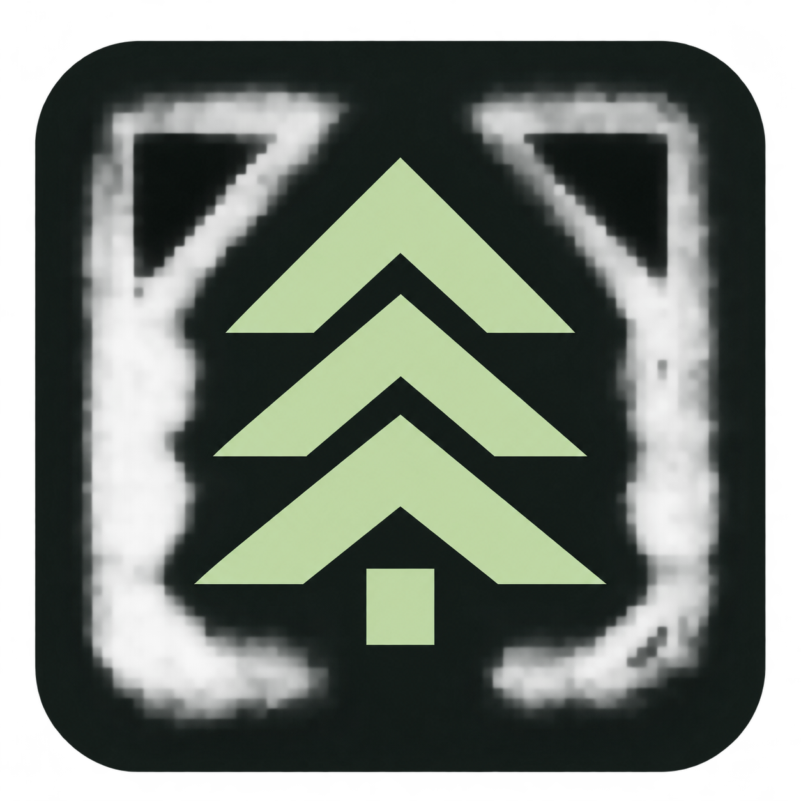

<p align="center"></p>

# Pino Workbench

**웹 기술 없이 만든 Go 데스크톱 작업 공간.** Windows와 macOS를 대상으로 하며, UI는 Fyne 위젯으로 직접 그립니다. Electron, React, Node.js, HTML/CSS, WebView를 사용하지 않습니다. 별도의 Pino 서버나 계정도 필요 없습니다.

사용자가 설정한 MCP 서버에서 Jira·Confluence 맥락을 모으고, API 시나리오를 로컬에서 실행·검증·공유합니다. MIT 라이선스의 초기 프로토타입입니다.

## 실행

Go 1.26.1 이상과 플랫폼 C 개발 도구가 필요합니다.

- **macOS:** Xcode Command Line Tools (`xcode-select --install`).
- **Windows:** MSYS2/MinGW-w64 GCC를 설치하고 `gcc`가 PATH에서 실행되도록 설정하세요.
- Git 저장소 기능에는 Git이 필요합니다. 연결할 MCP 서버와 AI CLI는 사용자가 별도로 설치·인증합니다.

```sh
go mod download
go run ./cmd/pino
```

```sh
go build -trimpath -o build/ ./cmd/pino
go vet ./...
go test ./...
go test -race ./internal/model ./internal/vault ./internal/runner ./internal/connectors
```

Windows GUI 배포 실행 파일은 콘솔 창 없이 빌드할 수 있습니다.

```powershell
go build -trimpath -ldflags="-H=windowsgui" -o build/pino.exe ./cmd/pino
```

macOS 앱 번들:

```sh
go build -trimpath -o build/pino ./cmd/pino
go run fyne.io/tools/cmd/fyne@v1.7.4 package --os darwin --exe build/pino --name "Pino Workbench" --app-id dev.pino.workbench --app-version 0.2.0 --icon assets/icon.png
```

배포 서명·Apple notarization·자동 업데이트는 아직 구성하지 않았습니다. Windows는 Windows 빌드 환경에서 검증해야 합니다. CI에 macOS/Windows 네이티브 빌드와 테스트를 설정했습니다. Fyne 빌드는 CGO 및 플랫폼 라이브러리를 사용하므로 일반 Go CLI처럼 타깃 환경 변수만 바꿔 크로스 컴파일할 수 있는 것은 아닙니다.

## 업무 맥락

- 처음 실행하면 명확히 표시된 데모 이슈와 문서가 나옵니다.
- **서비스 연결**에서 Jira와 Confluence의 MCP 설정을 저장합니다.
- **업무 공간**에서 Jira JQL, Confluence 검색어로 자료를 가져옵니다. 최대 50개를 표시합니다.
- 이슈와 참고 문서를 선택하여 원문 링크·내보낸 시각을 포함한 Markdown을 저장합니다.
- 로컬 Git 저장소를 선택하면 실제 Git 루트를 검증하고 경로를 로컬 설정에 저장합니다.

외부 문서는 텍스트로 표시하며 명령으로 실행하지 않습니다. 검색 결과에 전체 본문이 없으면 별도 상세 조회는 아직 하지 않습니다.

## 서비스별 MCP 연결

지원 프로필: Jira, Confluence, GitHub, Notion, Google, Claude, Codex.

1. **stdio:** 실행 파일과 JSON 명령 인자 배열을 설정합니다. 환경 변수/토큰은 인증 입력란에 넣습니다.
2. **http:** Streamable HTTP MCP 주소를 설정합니다. 원격 주소는 HTTPS, localhost는 HTTP도 허용합니다. 인증 입력란에 `{"Authorization":"Bearer ..."}` 등의 헤더를 지정합니다.
3. 인증 입력란의 **빈칸은 기존 값 유지**, **`{}`는 삭제**, 새 객체는 전체 교체입니다. 저장된 값은 다시 입력란에 표시하지 않고 키 이름만 보여줍니다.
4. **로컬에 저장**만 누르면 명령을 실행하거나 네트워크에 접속하지 않습니다.
5. **MCP 연결 테스트**는 저장한 설정으로 서버에 접속하여 도구 이름과 입력 스키마를 조회합니다. 명령·주소 변경 시 기존 인증 값을 자동 전달하지 않고 재입력을 요구합니다.
6. Jira·Confluence는 읽기 전용 검색 도구, 인자, 결과 배열 경로를 지정합니다.

예: `search` 도구가 `jql`을 받으며 `{"issues":[...]}`를 반환한다면 도구 인자는 `{"jql":"{{query}}"}`, 배열 경로는 `issues`입니다. `data.results`처럼 중첩 경로를 사용할 수 있고 루트 배열은 빈 경로를 사용합니다. 서버마다 스키마가 다르므로 제공되는 도구 목록을 확인하세요.

Jira는 `key`, `summary/title` 또는 `fields.summary`, 설명·상태·담당자 등의 일반적인 형식을 지원합니다. Confluence는 `id`, `title`, `text/content` 등을 지원합니다. 결과가 URL을 제공하지 않으면 원문 기본 주소로 링크를 만듭니다. 자연어 결과를 임의로 해석하지 않고 JSON 결과를 요구합니다.

GitHub·Notion·Google은 현재 MCP 설정 저장·도구 조회까지 지원합니다. AI 프로필은 실행 경로·인자·환경 변수 저장까지 지원합니다. **Claude·Codex 로그인은 설치된 CLI에서 사용자가 직접 진행**하며 Pino는 다른 앱의 로그인 정보를 복사하지 않습니다. AI 실행·내장 터미널, 브라우저 OAuth, 자동 토큰 갱신, 기존 SSE 서버는 아직 지원하지 않습니다.

## API 시나리오

**API 시나리오**에서 요청을 만들고 위·아래 버튼으로 순서를 바꿉니다. **현재 이슈 연결**로 Jira 이슈 키를 연결할 수 있습니다. Jira 자체를 수정하지는 않습니다.

- HTTP 메서드·URL·헤더·본문 입력
- 로컬 변수 `{{baseUrl}}`, `{{token}}` 치환
- 응답 → 변수: `{"token":"token","userId":"data.id"}`
- JSON 값 검증: `[{"path":"ok","equals":true}]`
- 예상 상태 코드 검증, 첫 실패에서 중단, 실행 중 Stop
- 실제 상태·시간·응답 본문 표시
- Pino API JSON v1 파일 공유·가져오기

URL/헤더/본문 변수 치환은 **원문 문자열 치환**입니다. JSON 본문에 따옴표 등을 포함한 값을 사용할 때는 적절히 이스케이프해야 합니다. 응답 경로는 `data.id`, `users.0.id` 형식이며 추출 값은 문자열·숫자·불리언이어야 합니다.

공유 파일은 요청 정의·이슈 키만 포함합니다. **로컬 변수와 실행 결과는 공유하지 않습니다.** 직접 입력한 URL·헤더·본문·예상 값은 공유되므로 인증 값은 로컬 변수에 보관하세요. 알려진 로컬/추출 변수의 문자열은 실행 결과에서 가리지만 응답의 모든 민감한 데이터를 자동 판별하는 기능은 아닙니다.

가져오기는 새로운 ID와 빈 로컬 변수로 저장하며 자동 실행하지 않습니다. 동료는 자기 환경의 변수를 입력한 뒤 실행할 수 있습니다. 현재 공유는 파일/Git 방식이며 팀 실시간 동기화나 Postman Collection 호환은 없습니다.

제한: 시나리오당 30개 요청, 로컬 시나리오 100개, 요청당 15초, 응답 1 MB. 리디렉션은 자동으로 따라가지 않습니다. GET/HEAD 요청 본문, 쿠키 세션, multipart 업로드, 스크립트 실행, 클라이언트 인증서는 지원하지 않습니다. 실행 취소는 이미 서버에서 처리한 변경을 되돌리지 않습니다.

## 로컬 보안 저장소

- `os.UserConfigDir()/pino-workbench/vault.enc`에 설정·인증 값·시나리오·변수·저장소 경로를 **AES-256-GCM**으로 암호화하여 저장합니다.
- 키는 macOS Keychain / Windows Credential Manager에 `dev.pino.workbench` 서비스로 저장합니다. 파일 옆에 평문 키를 두지 않습니다.
- OS 키체인 접근이 실패하면 평문 모드로 전환하지 않습니다. 기존 파일을 보존하고 오류를 보여줍니다.
- 저장은 잠금·임시 파일·원자적 교체를 사용합니다. 동일 설정 저장소로 앱 두 개를 동시에 실행하지 못하도록 파일 잠금을 둡니다.
- 서비스/시나리오 삭제는 Pino에 저장한 해당 설정과 비밀 값을 삭제합니다. 외부 서버의 토큰 폐기나 AI CLI 로그아웃을 대신하지 않습니다.
- 내보낸 Markdown과 공유 JSON은 사용자가 선택한 **평문 파일**입니다.
- 원격 MCP/API를 실행하면 필요한 데이터는 사용자가 지정한 서버로 전송됩니다. 로컬 앱은 모든 외부 서비스가 오프라인이라는 의미는 아닙니다.

### Electron 버전에서 전환

웹 기반 구현은 소스와 빌드에서 제거했습니다. 이전 코드는 Git 이력에 남습니다. 기존 Electron `connections.enc` / `api-scenarios.enc`는 자동 변환·삭제하지 않습니다. 인증 설정은 새 앱에서 다시 입력하세요. 기존 **Pino API JSON v1 공유 파일은 가져올 수 있습니다.**

## 구조

```text
cmd/pino/             네이티브 앱 진입점
internal/ui/          Fyne 위젯, 화면, 작업 상태
internal/model/       프로필·시나리오 모델, 공유 형식, 검증
internal/vault/       OS 키체인과 AES-GCM 로컬 저장
internal/connectors/  공식 Go MCP SDK, Jira/Confluence 변환, Git
internal/runner/      net/http 순차 요청·검증·취소
assets/               로고와 한글 폰트, 라이선스
```

로고는 [assets/icon.png](assets/icon.png)에 있습니다. 앱 아이콘에 적용했으며 자세한 설명과 폰트 출처는 [assets/README.md](assets/README.md)를 참고하세요. 앱은 MIT, 포함한 Noto Sans KR 폰트는 SIL OFL입니다.

네이티브 창 확인용 명령은 사용자 키체인을 건드리지 않는 임시 저장소로 창을 띄우고 PNG를 저장한 뒤 종료합니다.

```sh
mkdir -p tmp
go run ./cmd/pino --smoke-output tmp/native.png
go run ./cmd/pino --smoke-output tmp/api.png --smoke-page api
```

## 현재 범위

macOS 네이티브 빌드·실행, Go 단위/통합 테스트 및 Fyne 위젯 테스트로 검증합니다. 실제 회사 MCP 계정, OS 키체인 권한 정책, Windows 설치 환경은 별도 확인이 필요합니다. worktree·AI 실행·내장 터미널·diff·GitHub PR 생성·OAuth는 후속 개발 범위입니다.

[GitHub](https://github.com/pinomaker-hoo/pino-workbench) · [Fyne 문서](https://docs.fyne.io/) · [공식 MCP Go SDK](https://github.com/modelcontextprotocol/go-sdk)
